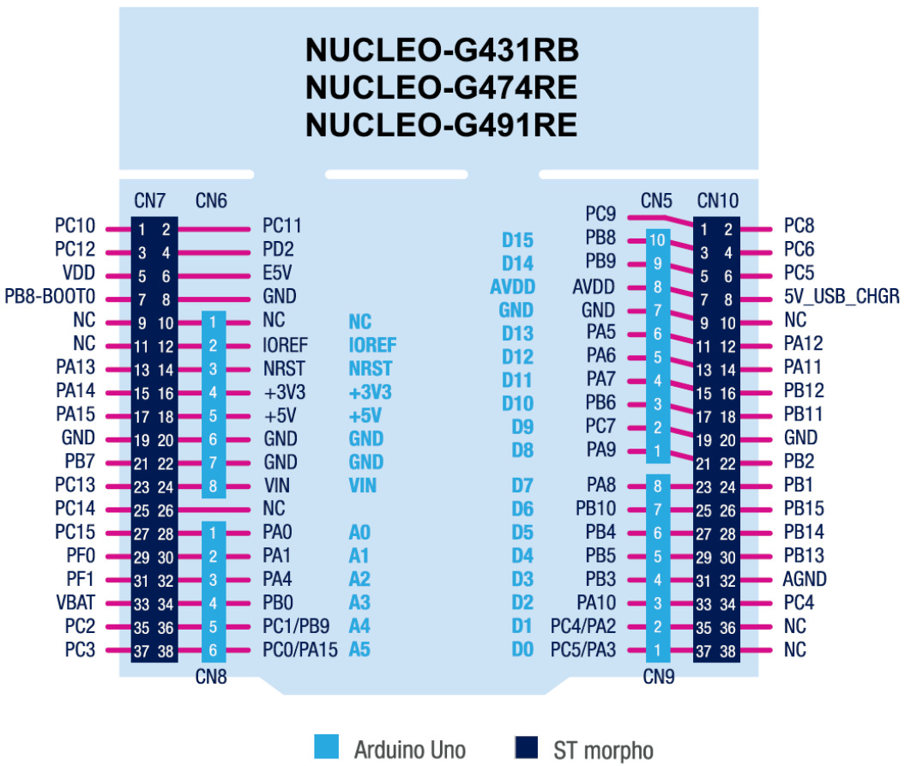
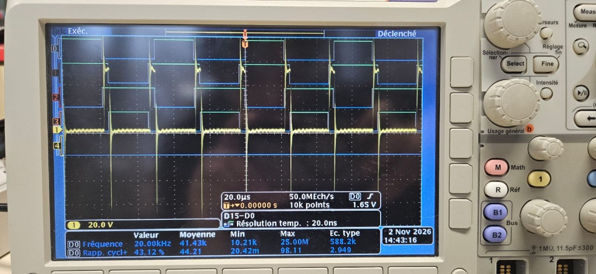
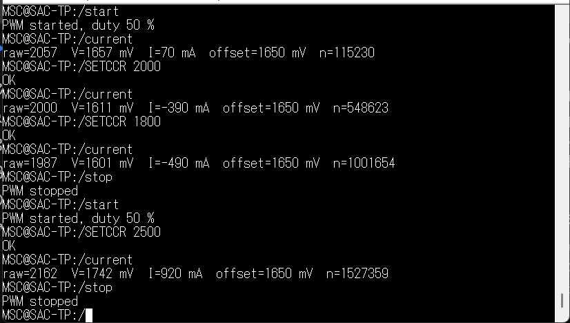

# 2526 ESE — Actionneur & Automatique Avancée



## Commande MCC basique

### Génération de 4 PWM en complémentaire décalée

Le pont en H est piloté par **TIM1** en mode **center-aligned** : deux bras U et V, chacun avec un transistor high et un low, soit 4 signaux.

| Signal | Broche | Rôle |
|---|---|---|
| CH1 — `U_PWM_H` | PA8 | High-side bras U |
| CH1N — `U_PWM_L` | PB13 | Low-side bras U |
| CH2 — `V_PWM_H` | PA9 | High-side bras V |
| CH2N — `V_PWM_L` | PB14 | Low-side bras V |

Le bras V est décalé de 180° : `CCR2 = ARR − CCR1`. La tension moteur résultante est :

$$V_{mot} = (2\alpha - 1) \cdot V_{bus}$$

**Fréquence de découpage**

Avec PSC = 0, ARR = 4249, horloge TIM1 = 170 MHz, mode centré :

$$f_{PWM} = \frac{170\,\text{MHz}}{2 \times (4249+1)} = \frac{170\,\text{MHz}}{8500} \approx \mathbf{20\,\text{kHz}}$$

Résolution : $\log_2(4250) \approx 11{,}9$ bits.

**Temps mort**

L'IRF540N a un temps de blocage typique $t_{d(off)} + t_f = 39 + 35 = 74\,\text{ns}$ (datasheet Infineon, $V_{DD}=50\,\text{V}$, $R_G=5{,}1\,\Omega$). En ajoutant le délai de propagation du driver HCPL-315J (~150 ns) et la résistance de grille du PCB, on retient :

$$DTG = 34 \implies DT = 34 \times \frac{1}{170\,\text{MHz}} \approx \mathbf{200\,\text{ns}}$$

soit < 0,4 % de la période — impact négligeable sur le rapport cyclique effectif.

**Vérification — signaux complémentaires**



Fréquence mesurée : **20 kHz** .

**Vérification — temps mort (100 ns/div, 2,50 GS/s)**


DTG = 34 → ~200 ns.

---

## Commande de la vitesse

### Boucle ouverte via shell UART

La vitesse est commandée depuis un terminal série (**115200 bauds, 8N1**) via un shell sur USART2.

**Limites du rapport cyclique**  :

```c
#define PWM_MAX        4250U           // ARR + 1
#define MOTOR_CCR_MAX  3825U           // 90 %
#define MOTOR_CCR_MIN  (PWM_MAX - MOTOR_CCR_MAX)  // 10 %
```

**Mise à jour des CCR** :

```c
void motor_set_ccr(uint32_t ccr) {
    ccr = CLAMP(ccr, MOTOR_CCR_MIN, MOTOR_CCR_MAX);
    __HAL_TIM_SET_COMPARE(&htim1, TIM_CHANNEL_1, ccr);
    __HAL_TIM_SET_COMPARE(&htim1, TIM_CHANNEL_2, PWM_MAX - ccr);
}
```

**Rampe logicielle** (appelée dans `loop()`) :

```c
#define RAMP_STEP      5U    
#define RAMP_PERIOD_MS 10U  
// plage complète (425→3825) ≈ 6,8 s
```

**Commandes** :

| Commande | Description |
|---|---|
| `start` | Démarre le PWM à α = 50 % |
| `stop` | Arrête le PWM |
| `speed XXXX` | Rampe vers CCR = XXXX |
| `SETCCR XXXX` | CCR immédiat |
| `led on/off/toggle` | LED utilisateur PA5 |
| `help` | Liste toutes les commandes |

---

### Mesure de courant

D'après le schéma KiCad, deux courants sont disponibles sur la carte :
`U_Imes`:  PA1, ADC1, IN2, Courant de phase U
`Bus_Imes`: PC2, ADC1, IN8, Courant de bus DC 

Le courant de bras est mesuré via **ADC1** (12 bits, canal IN2 — broche PA1 `U_Imes`) synchronisé avec le PWM et filtré numériquement. 

#### Fonction de transfert du capteur

Le capteur de courant utilisé est le **HCPL-7800A**. Il mesure la tension aux bornes d'un shunt résistif et délivre une tension analogique isolée proportionnelle au courant.

D'après la datasheet HCPL-7800A :
- Gain interne : **8,2 V/V**
- Plage de sortie centrée sur $V_{cc}/2$
- Largeur de bande : ~100 kHz

La chaîne de mesure complète a pour fonction de transfert statique :

$$H_{capteur}(s) \approx K_{capteur} = \frac{V_{out}}{I_{mesure}} = \mathbf{100\,\text{mV/A}}$$

avec un offset de **1650 mV** correspondant à $V_{cc}/2 = 3300/2$ mV à courant nul.

La conversion courant ↔ tension est :

$$V_{out}(mV) = 1650 + 100 \times I(A)$$
$$I(mA) = \frac{V_{out}(mV) - 1650}{100} \times 1000$$


#### Première mesure en polling

Avant la mise en place de la chaîne DMA, la mesure a été validée en mode **polling** : conversion ADC déclenchée manuellement via `HAL_ADC_Start()` / `HAL_ADC_PollForConversion()`.

#### Chaîne d'acquisition Timer/ADC/DMA

Une fois validée, la mesure est rendue périodique et synchrone aux PWM via la chaîne :

TIM1 (TRGO update, 20 kHz)
  → déclenche ADC1 (ExternalTrigConv = ADC_EXTERNALTRIG_T1_TRGO)
  → DMA circulaire → buffer adc_buf[2]
  → callback HAL_ADC_ConvHalfCpltCallback / ConvCpltCallback
  → filtre IIR ×16

**Filtre IIR (moyennage ×16) :**

```c
static inline void new_sample(uint16_t raw) {
    filt16 += raw - (filt16 >> 4);  // filt = 15/16 * filt + 1/16 * raw
}
```

**Conversion en mA :**

$$I_{mA} = \frac{(V_{mV} - V_{offset}) \times 1000}{S_{mV/A}} \quad S = 100\,\text{mV/A},\quad V_{offset} = 1650\,\text{mV}$$

```c
#define SENSOR_SENS_MV_A  100     // 100 mV/A
#define ADC_VREF_MV       3300
#define ADC_FULL_SCALE    4095

int32_t input_analog_get_mA(void) {
    int32_t v_mV = (int32_t)((raw * ADC_VREF_MV) / ADC_FULL_SCALE);
    return ((v_mV - offset_mV) * 1000) / SENSOR_SENS_MV_A;
}
```

**Commandes shell :**

| Commande | Description |
|---|---|
| `current` | `raw` · `V (mV)` · `I (mA)` · `offset (mV)` · `n échantillons` |
| `current zero` | Recale l'offset sur la valeur courante |



---

### Mesure de vitesse (Implémenté, non testé)

La vitesse est mesurée via l'encodeur incrémental couplé au moteur sur **TIM3** (mode Hall Sensor, 3 canaux : PA4, PA6, PC8). La résolution est de 1024 impulsions/tour en mode quadrature × 4.

#### Fonction de transfert du capteur de vitesse

$$\omega(rad/s) = \frac{\Delta_{cnt} \times 2\pi}{N_{cpp} \times T_s}$$

La fonction de transfert discrète du capteur est un **différenciateur du premier ordre** avec retard :

$$H_{enc}(z) = \frac{2\pi}{N_{cpp} \cdot T_s} \cdot \frac{z - 1}{z}$$

soit en continu (approximation à basse fréquence, $T_s = 10\,\text{ms}$) :

$$H_{enc}(s) \approx \frac{2\pi}{N_{cpp} \cdot T_s} \cdot \frac{s \cdot T_s}{1 + s \cdot T_s} \approx \frac{2\pi}{N_{cpp}} \cdot s \quad \text{pour } f \ll \frac{1}{T_s}$$

#### Constante de temps mécanique du moteur

La constante de temps mécanique $\tau_m$ est identifiable expérimentalement en appliquant un **échelon de tension** au moteur et en relevant la réponse de vitesse (sonde tachymétrique) :

$$\tau_m = \frac{J}{f + K_e^2 / R}$$

où $J$ = moment d'inertie, $f$ = frottements visqueux, $K_e$ = constante de FEM, $R$ = résistance d'induit.

> Non mesurée lors de la séance (encodeur non testé). La mesure consiste à appliquer un échelon via `SETCCR` et relever le temps pour atteindre 63 % de la vitesse finale.

#### Fréquence d'asservissement

La fréquence d'échantillonnage de la vitesse est fixée à **100 Hz** ($T_s = 10\,\text{ms}$), ce qui donne :
- une résolution minimale de 1 top/période = $60000 / (4096 \times 10) \approx 1{,}5\,\text{RPM}$
- une largeur de bande de boucle utilisable d'environ $f_{boucle} \leq f_s / 10 = \mathbf{10\,\text{Hz}}$
