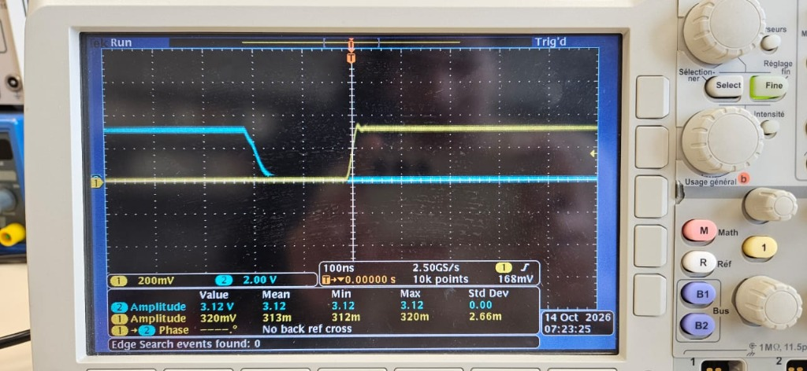

# 2526 ESE — Actionneur & Automatique Avancée


## Commande MCC basique

### Génération de 4 PWM en complémentaire décalée

Le pont en H est piloté par **TIM1** en mode **center-aligned** : deux bras U et V, chacun avec un transistor high et un low, soit 4 signaux.

| Signal | Broche | Rôle |
|---|---|---|
| CH1 — `U_PWM_H` | PA8 | High-side bras U |
| CH1N — `U_PWM_L` | PB13 | Low-side bras U |
| CH2 — `V_PWM_H` | PA9 | High-side bras V |
| CH2N — `V_PWM_L` | PB14 | Low-side bras V |

Le bras V est décalé de 180° : `CCR2 = ARR − CCR1`. La tension moteur résultante est :

$$V_{mot} = (2\alpha - 1) \cdot V_{bus}$$

**Fréquence de découpage**

Avec PSC = 0, ARR = 4249, horloge TIM1 = 170 MHz, mode centré :

$$f_{PWM} = \frac{170\,\text{MHz}}{2 \times (4249+1)} = \frac{170\,\text{MHz}}{8500} \approx \mathbf{20\,\text{kHz}}$$

Résolution : $\log_2(4250) \approx 11{,}9$ bits.

**Temps mort**

L'IRF540N a un temps de blocage typique $t_{d(off)} + t_f = 39 + 35 = 74\,\text{ns}$ (datasheet Infineon, $V_{DD}=50\,\text{V}$, $R_G=5{,}1\,\Omega$). En ajoutant le délai de propagation du driver HCPL-315J (~150 ns) et la résistance de grille du PCB, on retient :

$$DTG = 34 \implies DT = 34 \times \frac{1}{170\,\text{MHz}} \approx \mathbf{200\,\text{ns}}$$

soit < 0,4 % de la période — impact négligeable sur le rapport cyclique effectif.

**Vérification — signaux complémentaires**


Fréquence mesurée : **20 kHz** .

**Vérification — temps mort (100 ns/div, 2,50 GS/s)**



DTG = 34 → ~200 ns.

---

## Commande de la vitesse

### Boucle ouverte via shell UART

La vitesse est commandée depuis un terminal série (**115200 bauds, 8N1**) via un shell sur USART2.

**Limites du rapport cyclique**  :

```c
#define PWM_MAX        4250U           // ARR + 1
#define MOTOR_CCR_MAX  3825U           // 90 %
#define MOTOR_CCR_MIN  (PWM_MAX - MOTOR_CCR_MAX)  // 10 %
```

**Mise à jour des CCR** :

```c
void motor_set_ccr(uint32_t ccr) {
    ccr = CLAMP(ccr, MOTOR_CCR_MIN, MOTOR_CCR_MAX);
    __HAL_TIM_SET_COMPARE(&htim1, TIM_CHANNEL_1, ccr);
    __HAL_TIM_SET_COMPARE(&htim1, TIM_CHANNEL_2, PWM_MAX - ccr);
}
```

**Rampe logicielle** (appelée dans `loop()`) :

```c
#define RAMP_STEP      5U    
#define RAMP_PERIOD_MS 10U  
// plage complète (425→3825) ≈ 6,8 s
```

**Commandes** :

| Commande | Description |
|---|---|
| `start` | Démarre le PWM à α = 50 % |
| `stop` | Arrête le PWM |
| `speed XXXX` | Rampe vers CCR = XXXX |
| `SETCCR XXXX` | CCR immédiat |
| `led on/off/toggle` | LED utilisateur PA5 |
| `help` | Liste toutes les commandes |
